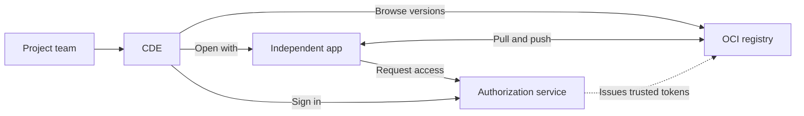
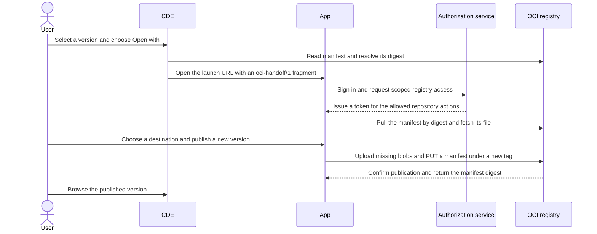

# An open common data environment over OCI

A project team should be able to keep its files and versions under its own
control, then choose an independent tool for each task. An architect could
open an issued IFC model from their organization's CDE in a viewer. A
validator could read that exact model and publish a report to a repository
the team has chosen. Each organization can operate its own registry or use
a hosting provider.

The proposal combines standard file delivery and authorization with a small
browser handoff. An application can use the same flow with several CDEs once
it has a connection and permission for each. Each tool still needs to
understand the file types it handles.

## Who does what



| Component | Responsibility |
| --- | --- |
| CDE | Organizes project files and versions, checks what the user can read, and offers compatible apps. |
| Registry | Stores manifests, blobs, and tags. Enforces repository access on every request. |
| Authorization service | Authenticates people and issues scoped tokens according to the owner's policy. |
| Application | Interprets the file, performs the work, and publishes the result to the user's chosen destination. |

A file version is represented by an OCI manifest pointing to content-addressed
blobs. A tag gives a version a name people can browse. A manifest digest
identifies the exact version even if someone moves a tag. OCI carries the
package. A domain standard such as IFC supplies the meaning of its contents.

## Open with and publish



The app authorizes a different destination independently. The registry
checks pull and push separately. If it denies an operation, the app stops
that operation and tells the user which access they need. A successful
manifest PUT completes publication. The CDE can discover the version through
its regular listing.

## What implementations agree on

**Packaging and transfer.** Use an OCI image manifest with a top-level
`artifactType` identifying the package format. Document what each type
contains so different tools can implement it. For a single-file package,
put the file in one layer with its own media type and use the OCI empty
config. Apps download the manifest and layer by digest and check the bytes
against those digests. Use the registry's OCI APIs directly for transfers.
[OCI Image manifest](https://github.com/opencontainers/image-spec/blob/v1.1.1/manifest.md)
· [OCI Distribution](https://github.com/opencontainers/distribution-spec/blob/v1.1.1/spec.md)

**App registration.** The CDE needs the app's display name, launch URL,
and supported `artifactType` values with a `view` or `edit` intent for
each. For example, a tool can edit one type of model and view two types of
report. The CDE compares each declaration to the manifest's exact
`artifactType` and offers the matching actions. Each identity provider
registers the app's exact OAuth callback URLs. CDEs can choose how to
collect and store registrations.

**Handoff.** Append `#handoff=<encoded>` to the registered launch URL. The
value is unpadded base64url of the UTF-8 `oci-handoff/1` JSON message below.

```json
{
  "protocol": "oci-handoff/1",
  "source": {
    "registry": "https://registry.example.org",
    "repository": "project/model",
    "digest": "sha256:32982f1d25a7c6d12f627c1fbc5d3d09df56514c3a24de7647bcc6808d6be214"
  },
  "intent": "edit"
}
```

The fragment carries a locator and a UI hint without credentials. An
optional `destination` can suggest a registry and repository. The app
checks the registry against a configured connection, clears the fragment
after parsing, and requests its own access. The CDE's repository token
stays with the CDE.

**Authentication and authorization.** A browser app configures the issuer
and public client ID for each connection, uses OpenID Connect discovery and
OAuth Authorization Code with PKCE S256, and verifies the issuer on
return. It requests access for the registry resource. The registry or its
trusted gateway validates the token's signature, issuer, audience, and
expiry before repository permissions are enforced. Native clients can
follow the registry's Distribution Bearer challenge. Repository scope can
grant pull, push, or both. The handoff digest selects content, while the
grant applies at repository scope. Browser connections also need the
app's exact origin allowed at the token endpoint and registry.
[OpenID Connect discovery](https://openid.net/specs/openid-connect-discovery-1_0.html)
· [RFC 7636](https://www.rfc-editor.org/rfc/rfc7636.html)
· [RFC 9207](https://www.rfc-editor.org/rfc/rfc9207.html)
· [RFC 8707](https://www.rfc-editor.org/rfc/rfc8707.html)
· [OAuth security BCP](https://www.rfc-editor.org/rfc/rfc9700.html)
· [Distribution token authentication](https://distribution.github.io/distribution/spec/auth/token/)

To check interoperability, open a version from one CDE with an independent
app and publish a revision to a second CDE. Verify that the second CDE
shows the new digest and that publication requires write access there.

## The Subsoil example

Subsoil is the CDE, Zot is the registry, and Keycloak issues tokens.
Envoy validates those tokens at the public registry address. The demo
provisions a private repository per verified account, binds registered apps
to that workspace, and accepts browser apps on `http://localhost:5173`.
Other CDEs can choose their own project structure, access policy, and
registration interface. The shared boundary is the OCI package and
transfer, the agreed authorization flow, and the proposed handoff.

[Try the starter editor](DEVELOPMENT.md) to see a version opened and
published by an independent client.
