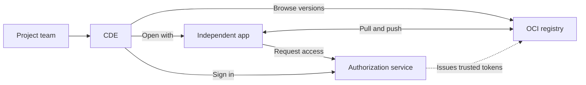
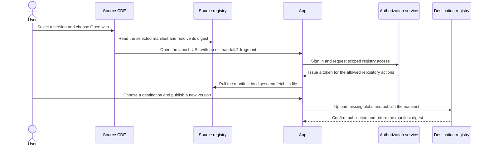

# An open common data environment over OCI

A project team should be able to keep its files and versions under its own
control, then choose an independent tool for each task. An architect could
open an issued IFC model from their organization's CDE in a viewer. A
validator could read that exact model and publish a report to a repository
the team has chosen. Each organization can operate its own registry or use
a hosting provider.

The proposal combines standard file delivery and authorization with a browser
handoff. A **handoff** tells an app which published file version to open and
whether the user chose **Open with…** or **Edit with…**. The app uses a
configured **connection** to the registry and its sign-in service. It can use
the same flow with several CDEs when it has a connection and permission for
each. Each app needs to understand the files it handles.

## Who does what



| Component | Responsibility |
| --- | --- |
| CDE | Organizes project files and versions and offers compatible apps for the selected version. |
| Registry | Stores manifests, blobs, and tags. Enforces repository access on every request. |
| Authorization service | Authenticates people and issues scoped tokens according to the owner's policy. |
| Application | Interprets the file, performs the work, and publishes the result to the user's chosen destination. |

A **file version** is the OCI package described by a manifest and its files.
The **version name**, called a tag in the registry API, is what people browse
and choose. The manifest **digest** identifies the exact version even if a
tag moves. A **folder** corresponds to an OCI repository, the address and
access boundary for a collection of versions. An **artifact type** tells an
app how to interpret a package. For example, an artifact type can tell the
app to expect a single model in IFC format.

## Open with and publish



The **source** is the registry, repository, and digest of the selected
version. The **destination** is the registry and repository the user chooses
for publication. It can be the source repository, another repository, or a
registry operated by another organization. The app obtains permission for
the destination and the registry checks read and publish access separately.
The published version appears in the CDE that lists the destination folder.

## What implementations agree on

### Package format

Use an OCI image manifest with a top-level `artifactType` identifying the
package format. Document the files, formats, and relationships each type
expects so different apps can interpret it. For a single-file package, put
the file in one layer with its own media type and use the OCI empty config.
Apps download the manifest and file blobs by digest and verify the received
bytes against the manifest digest and the blob descriptors. Live queries and
approved changes to a source system use the APIs supported by that system.
[OCI Image manifest](https://github.com/opencontainers/image-spec/blob/v1.1.1/manifest.md)
· [OCI Distribution](https://github.com/opencontainers/distribution-spec/blob/v1.1.1/spec.md)

### App registration

The CDE registers the app's display name, launch URL, and supported
`artifactType` values with a `view` or `edit` intent for each. For example, an
app can edit one type of model and view two types of report. The CDE compares
the registration to the manifest's exact `artifactType` and offers the
matching actions. The app's OAuth client registration specifies the exact
callback URLs. CDEs can choose how to collect and store app registrations.

### Browser handoff

Append `#handoff=<encoded>` to the registered launch URL. The value is
unpadded base64url of the UTF-8 `oci-handoff/1` JSON message below. Pin the
source to the digest resolved for the selected version so a tag change
between app selection and launch leaves the input stable.

```json
{
  "protocol": "oci-handoff/1",
  "source": {
    "registry": "https://registry.example.org",
    "repository": "project/model",
    "digest": "sha256:32982f1d25a7c6d12f627c1fbc5d3d09df56514c3a24de7647bcc6808d6be214"
  },
  "intent": "edit"
}
```

The registry value is an origin without a trailing slash. The repository is
the OCI repository name. This protocol version uses a `sha256:` manifest
digest. `view` and `edit` describe the user's requested action. The registry
determines which operations their token permits. An optional `destination`
can suggest an object with `registry` and `repository`. The app checks it
against a configured connection and asks the user before publishing there.

The app treats the fragment as untrusted input. It validates the protocol,
source, and intent against a configured connection before making requests,
then clears the fragment. The CDE keeps its own credentials. The app obtains
access independently.

### Access and publication

A browser app configures the issuer, public client ID, and callback for
each connection. It uses OpenID Connect discovery and OAuth Authorization
Code with PKCE S256, binds the handoff to OAuth `state`, and verifies the
issuer and state on return. It requests access for the registry origin as
the OAuth resource. Repository scopes grant `pull`, `push`, or both. The
digest selects content, and the grant applies at repository scope. The
registry or its trusted gateway validates the token's signature, issuer,
audience, and expiry before enforcing repository permissions. Native
clients can follow the registry's Distribution Bearer challenge. Browser
connections need the app's origin allowed at the token endpoint and registry,
including access to upload headers such as `Location`.
[OpenID Connect discovery](https://openid.net/specs/openid-connect-discovery-1_0.html)
· [RFC 7636](https://www.rfc-editor.org/rfc/rfc7636.html)
· [RFC 9207](https://www.rfc-editor.org/rfc/rfc9207.html)
· [RFC 8707](https://www.rfc-editor.org/rfc/rfc8707.html)
· [OAuth security BCP](https://www.rfc-editor.org/rfc/rfc9700.html)
· [Distribution token authentication](https://distribution.github.io/distribution/spec/auth/token/)

For a new version, upload missing blobs and put the output manifest under
a new tag. A successful manifest PUT completes publication. Use the output
digest to identify the exact version. For a report about an input version,
record the source registry, repository, and digest in the report's package.
When the input is available in the destination repository, an OCI `subject`
can also make the relationship discoverable through the Referrers API.

Keep credentials scoped to their registry. When the app writes to another
registry, it authorizes that connection separately. If access is denied,
tell the user which permission is needed. If a publication request times
out, check the destination tag and digest before retrying. A registry with
immutable version names needs to enforce that policy at the destination.

## The Subsoil example

Subsoil is the CDE, Zot is the registry, and Keycloak issues tokens.
Envoy validates those tokens at the public registry address. The demo
provisions a private repository per verified account, binds registered apps
to that workspace, and accepts browser apps on `http://localhost:5173`.
Start by [connecting an app](DEVELOPMENT.md) and publishing a new version in
that workspace. To check a connection to another registry, open a version
from one CDE and publish to a second CDE. Verify that the second CDE shows
the new digest and that publishing requires write access there.

An organization can also [run Subsoil locally](../README.md#try-it) or use
its own OCI registry, identity provider, and repository policy. Configure
the app with the registry origin, issuer, registered client and callback,
and the repository it can access. The same handoff identifies the source
version regardless of which organization operates the store.
